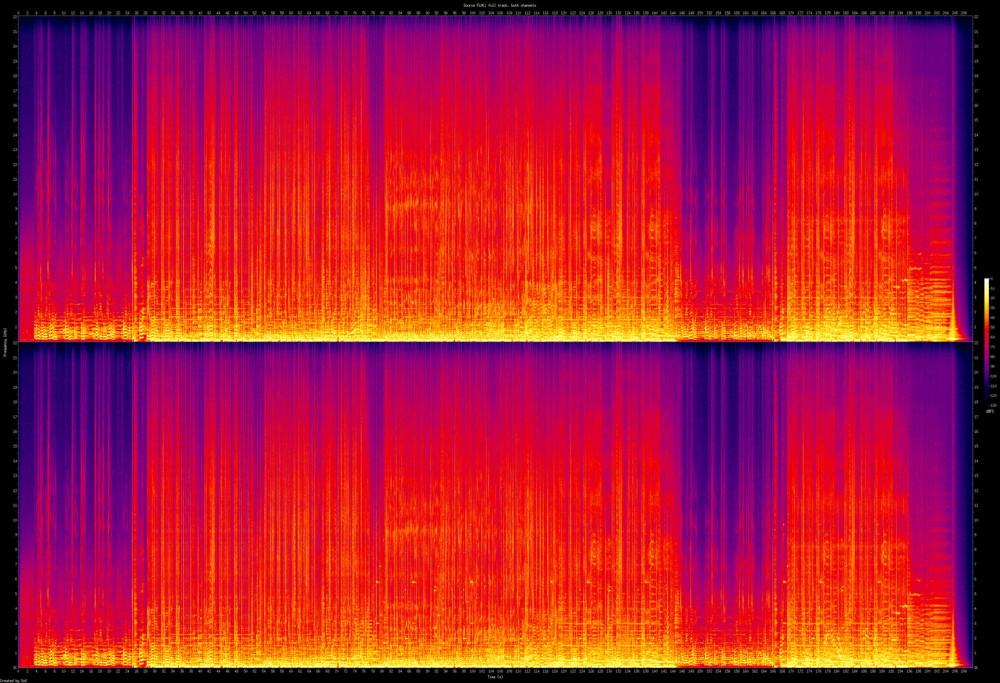
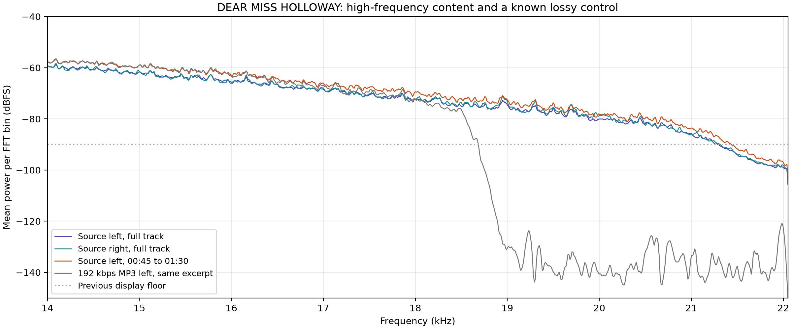
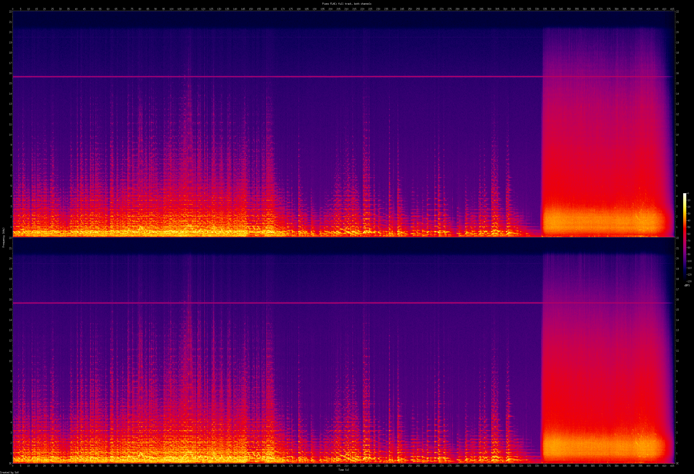
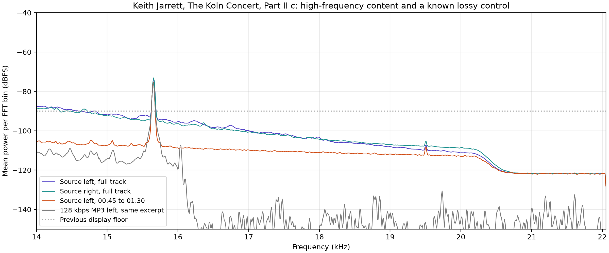
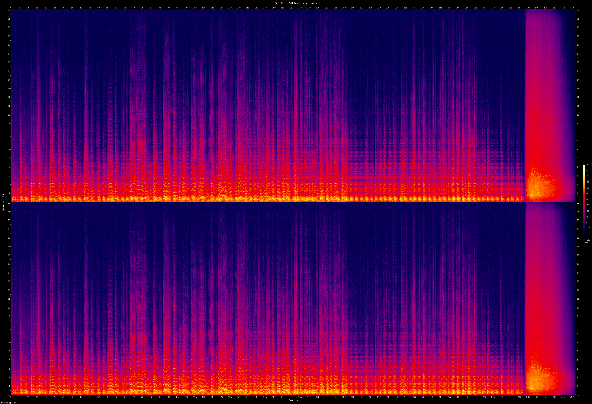
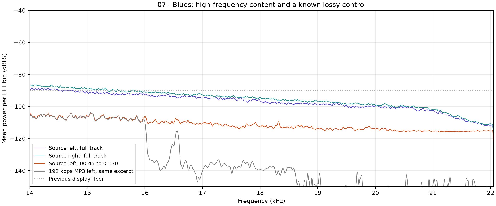

# Spectrogram quality and source analysis

Analyzed on 2026-10-11. The supplied `04 - DEAR MISS HOLLOWAY.flac` passes FLAC integrity verification and has spectral content consistent with a lossless source under the [Orpheus interview guide's spectral checks](https://interview.orpheus.network/spectral-analysis.php). Both channels carry faint content up to approximately 22 kHz. Neither shows a sustained sharp cutoff in the guide's typical MP3 cutoff region of 16 to 20.5 kHz.

This supports using the file as the lossless training example. A spectrogram cannot certify the complete encoding history, and FLAC integrity only establishes that the decoded samples match the file's stored checksum. High-frequency noise can also be added after lossy encoding. No original master was supplied for a sample comparison.

## Comparison with the classical example

The [official classical diagram](https://interview.orpheus.network/Guide-FLAC-Classical.jpg) shows weak background noise reaching about 22 kHz above the piano's main musical energy. The trainer now bundles that original image as [spectrum-b.jpg](../frontend/static/exercises/spectrum-b.jpg) and displays it with the classical question. The image is reproduced unchanged from the Orpheus interview preparation website, which is its source and attribution. Its original dimensions are 1000 by 385 pixels; it has not been upscaled or reconstructed.

Our old audio-derived diagrams used a colour scale ending at -90 dBFS. In the supplied excerpt, mean per-bin power between 21.5 and 22 kHz is around -94.5 dBFS in the left channel, and between 22 and 22.05 kHz it is around -97.9 dBFS. Those levels explain the nearly black upper band in the old image. Resolution alone would not reveal them.

The replacement diagrams use a fixed 0 to -130 dBFS scale for every encode, 3000 time columns and 1025 frequency rows, with a Kaiser window. The output PNGs are 3144 by 1123 pixels including axes. The linear frequency axis reaches the actual Nyquist frequency of 22.05 kHz. They show the left channel directly, avoiding cancellation from stereo downmixing. The audio-derived exercise diagrams apply a common amplitude factor of 0.5, or -6.02 dB, before conversion to integer PCM to prevent decoded MP3 peaks from clipping. Their footers record that analysis gain. The full-track verification plots and numerical tables below analyze the unattenuated sources. No denoising, synthetic noise, resampling or image interpolation is applied. The deeper floor also reveals the piano file's much quieter upper-band noise.

[Source excerpt with the wider range](../frontend/static/exercises/spectrum-a.png)

The supplied track is pop music, so its energy distribution differs from the sparse piano recording. The comparison concerns faint content above the main musical energy, rather than matching the two recordings' appearance.

## Verification

| Property | Result |
| --- | --- |
| Codec | FLAC |
| Sample rate | 44,100 Hz |
| Channels | 2 |
| Bit depth | 16 |
| Duration | 209.906939 seconds |
| `flac -t` | Passed, including stored decoded-audio MD5 |
| Stored audio MD5 | `071ccdb0d6c1a8fa975ce3f7e2572893` |
| File SHA-256 | `14f87fce2aceab272fe8b35a4484226977f9a1f96118aa0e293241a022017015` |
| FFmpeg full decode with `-xerror` | Passed |

The entire track was inspected in both channels, including quiet sections and the fade. Content rolls off toward Nyquist without the abrupt horizontal loss of upper frequencies seen in the deliberately generated MP3 comparison.

The numerical cross-check decoded the source to floating-point PCM without changing its sample rate or channel count. It used a 4096-sample four-term Blackman-Harris window, a 2048-sample hop, and a real FFT. Bin spacing is approximately 10.77 Hz. For interior bins, power is `abs(FFT(samples * window))^2 * (2 / sum(window))^2`; DC and Nyquist bins use half that amplitude factor. Powers were averaged across frames and across the bins in each reported band, then converted with `10 * log10(mean power)`. These are mean per-bin levels, not integrated band levels or a claim about an audible noise floor. Numerical measurements use a different window and time aggregation from the SoX display, so their pixel values need not match exactly.

The known lossy comparison uses the same 00:45 to 01:30 excerpt encoded with FFmpeg's `libmp3lame` at 192 kbps CBR. Its sharp decline near 18.5 to 19 kHz is absent from the source.

| Frequency band | Full source left | Full source right | Source excerpt left | MP3 192 excerpt left |
| --- | ---: | ---: | ---: | ---: |
| 18 to 19 kHz | -73.96 | -73.48 | -71.68 | -77.31 |
| 19 to 20 kHz | -77.33 | -76.72 | -75.38 | -133.25 |
| 20 to 20.5 kHz | -80.75 | -80.08 | -78.90 | -138.88 |
| 20.5 to 21 kHz | -83.31 | -83.38 | -81.14 | -130.81 |
| 21 to 21.5 kHz | -88.93 | -88.57 | -86.28 | -136.78 |
| 21.5 to 22 kHz | -96.72 | -96.44 | -94.54 | -130.91 |
| 22 to 22.05 kHz | -99.47 | -99.06 | -97.89 | -128.95 |

All levels above are in dBFS per FFT bin using the stated normalization.

### Correction of clipping artifacts

The first generated MP3 diagrams contained tall, narrow vertical streaks reaching 22 kHz. These were introduced by converting decoded MP3 directly into integer PCM. The reproduced 128 kbps pop excerpt decoded to peaks of approximately 1.107 in the left channel and 1.135 in the right channel, exceeding the integer PCM range. There were 237 left-channel and 240 right-channel samples above full scale. Clipping those peaks introduced broadband distortion at the corresponding times.

Rendering the same decoded MP3 with its amplitude halved before integer conversion removes the tall streaks. The generator now applies that same gain to all audio-derived exercise plots, while MP3 encoding still uses the unattenuated source excerpt. The MP3-to-FLAC examples receive the gain before writing 24-bit FLAC, and are rendered without a second attenuation. This retains a common analysis level across sources and encodes and prevents the conversion from creating misleading high-frequency bursts.

Fainter residual content above an MP3's main edge can still remain. The exercises retain the caveat that a spectrum alone cannot establish source history or an exact bitrate.

## Earlier piano recording

The second supplied file, `104-keith_jarrett-the_koln_concert-part_ii_c.flac`, is also 16-bit, 44.1 kHz stereo. Its duration is 416.693333 seconds. It passes `flac -t` and a full FFmpeg decode. Its stored decoded-audio MD5 is `d6efe35df82a3d11725f8cf343406925`; its file SHA-256 is `1732b8fc3256fa7ee1280c0264586f12afbc9478655bc2030a40ddb0d0f6c273`.

The recording looks compatible with lossless piano audio, but its spectrum is less conclusive than the pop file's. Musical energy is concentrated at low frequencies. Faint broadband content continues higher, with a rolloff around 20.1 to 20.6 kHz into a roughly -122 dBFS mean per-bin floor that continues to Nyquist. That floor is visible with the -130 dBFS range. The observed attenuation near 20.5 kHz overlaps the guide's MP3 320 reference region. Source or mastering filters and later added noise can also produce an upper-band rolloff with residual noise, so this unknown recording must not be presented as a verified lossless master or as a proven lossy transcode.

Its thin line near 15.6 kHz is a narrow band of energy with content on both sides, rather than a cutoff. The physical cause of that line was not established. The full-track view includes the piano performance, quieter sections and the audience applause near the end; both channels have the upper-band rolloff.

Using the same numerical analysis method as above:

| Frequency band | Full piano left | Full piano right | Piano excerpt left | MP3 128 excerpt left |
| --- | ---: | ---: | ---: | ---: |
| 18 to 19 kHz | -106.21 | -105.62 | -111.47 | -142.05 |
| 19 to 20 kHz | -109.53 | -107.78 | -112.19 | -143.85 |
| 20 to 20.5 kHz | -112.88 | -110.72 | -114.32 | -145.86 |
| 20.5 to 21 kHz | -121.20 | -120.73 | -121.28 | -145.72 |
| 21 to 21.5 kHz | -121.89 | -121.84 | -121.85 | -142.01 |
| 21.5 to 22 kHz | -121.89 | -121.86 | -121.87 | -142.92 |
| 22 to 22.05 kHz | -121.84 | -121.84 | -121.80 | -156.59 |

All levels are dBFS per FFT bin with the same normalization. The numerical lossy control shown here is decoded directly from the known 128 kbps MP3 of the earlier piano recording. These historical measurements use floating-point PCM and are unaffected by the exercise renderer's clipping correction.

This recording was the initial source for the piano exercises. It has been replaced by `07 - Blues.flac`; the measurements and plots above document why the earlier source was less conclusive. The question about its narrow line near 15.6 kHz has been replaced by a question about the displayed range, with a new question ID.

## Supplied Blues recording

Analyzed `07 - Blues.flac` on 2026-10-11. This file looks consistent with a lossless source under the Orpheus guide's spectral checks and provides a clearer sparse-music example than the earlier Keith Jarrett file. Both channels retain faint broadband content to approximately 22 kHz. There is no sustained sharp upper boundary in the guide's typical 16 to 20.5 kHz MP3 cutoff region. The full-track spectrum declines gradually toward Nyquist, and the 00:45 to 01:30 music excerpt also retains noise throughout the upper band. The conclusion does not depend solely on the broadband sound near the end of the track.

| Property | Result |
| --- | --- |
| Codec | FLAC |
| Sample rate | 44,100 Hz |
| Channels | 2 |
| Bit depth | 16 |
| Duration | 322.333333 seconds |
| `flac -t` | Passed, including stored decoded-audio MD5 |
| Stored audio MD5 | `adf346c0f79fb9e7b1d9c1c040778397` |
| File SHA-256 | `c6dca446a6b3a856c01876c9d5cffc8cda2b297ccf533cfcb07b5de07f7d13b0` |
| FFmpeg full decode with `-xerror` | Passed |

The numerical cross-check uses the same 4096-sample Blackman-Harris analysis and normalization described above. A deliberately generated 192 kbps CBR MP3 of the same music excerpt loses much of the faint upper-band content. Its strongest decline in this excerpt begins around 16 kHz, illustrating why an observed edge alone cannot establish the encoder bitrate.

| Frequency band | Full Blues left | Full Blues right | Blues excerpt left | MP3 192 excerpt left |
| --- | ---: | ---: | ---: | ---: |
| 18 to 19 kHz | -97.97 | -96.03 | -112.69 | -140.94 |
| 19 to 20 kHz | -99.40 | -97.91 | -113.84 | -150.61 |
| 20 to 20.5 kHz | -100.35 | -99.50 | -114.64 | -154.14 |
| 20.5 to 21 kHz | -101.61 | -100.60 | -115.36 | -151.20 |
| 21 to 21.5 kHz | -105.11 | -104.00 | -115.64 | -150.59 |
| 21.5 to 22 kHz | -110.11 | -109.48 | -115.37 | -150.82 |
| 22 to 22.05 kHz | -112.14 | -111.08 | -115.23 | -158.12 |

All levels are dBFS per FFT bin with the stated normalization. The source excerpt's faint upper-band noise would largely disappear below the former -90 dBFS display floor.

There is no clear spectral evidence of a lossy transcode in this file. It is suitable as a lossless-looking training example on that basis. This is a spectral assessment, not a sample comparison with an original master, so it cannot certify every step in the recording's history.

The trainer now uses the Blues excerpt in [diagram K](../frontend/static/exercises/spectrum-k.png) and a deliberately generated MP3 128 kbps to FLAC conversion of that excerpt in [diagram L](../frontend/static/exercises/spectrum-l.png). The two piano exercises cover sparse musical energy with faint noise reaching about 22 kHz and why conversion to FLAC cannot restore discarded frequencies. The display-floor exercise was removed because that knowledge is outside the interview guide. The regenerated diagram L has a main upper edge near 16 kHz. Its 128 kbps conversion is separate from the 192 kbps numerical control plotted above. See the [question audit](spectrogram-question-audit.md) for the guide basis of each remaining spectral question.

## Regeneration

Run [generate-spectrograms.sh](../scripts/generate-spectrograms.sh) with the supplied files as described in [scripts/README.md](../scripts/README.md). The source audio stays outside the bundled app. Diagrams A, C through I, K and L are generated locally; diagram B is the credited official classical reference.

Tools used for this analysis were FLAC 1.5.0, FFmpeg 9.0.1 with LAME 4.0, SoX 14.4.2, and NumPy/Matplotlib supplied through the project's pinned Nixpkgs input.
